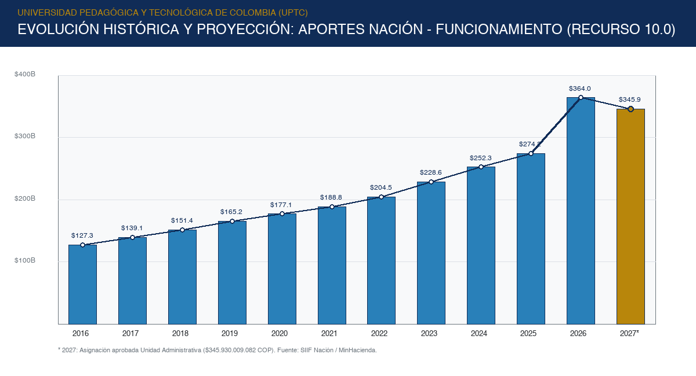
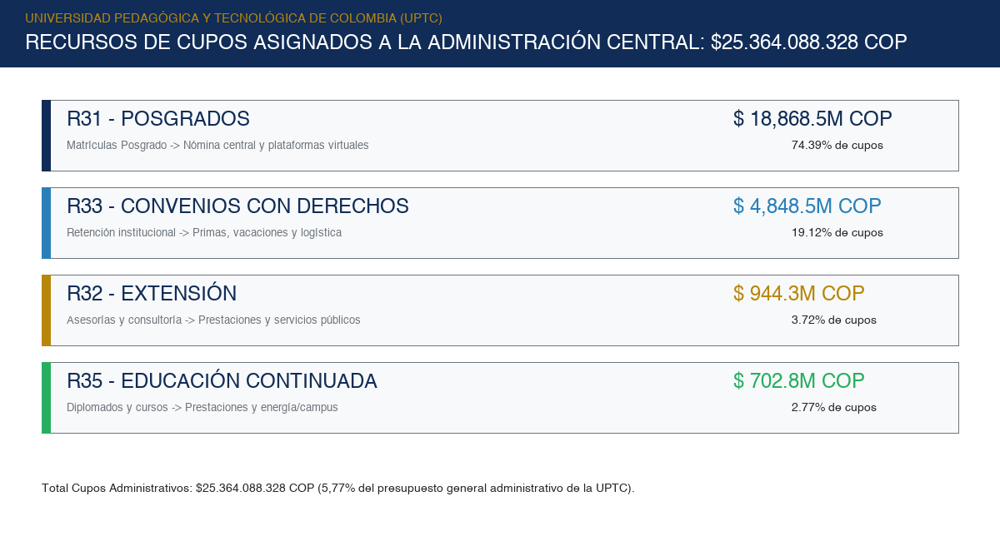
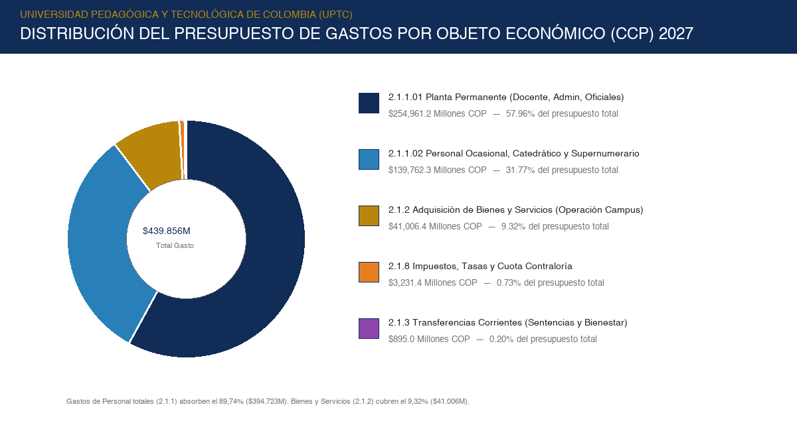
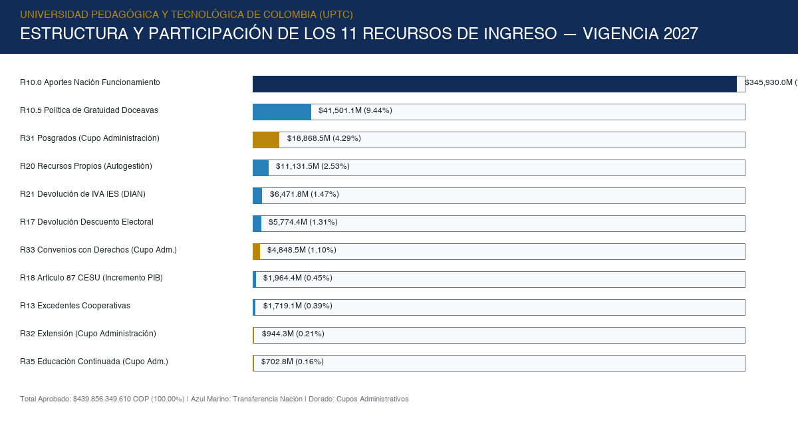
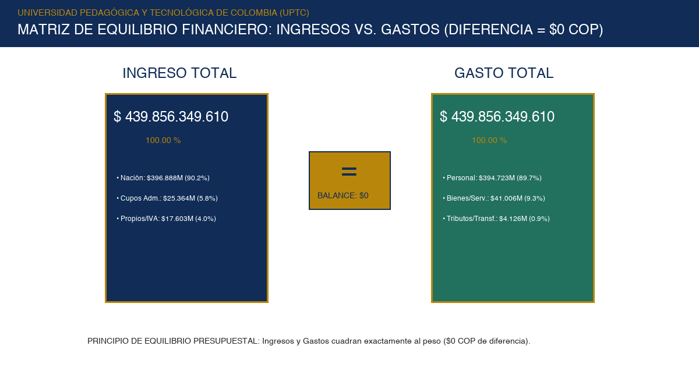

# DOCUMENTO TÉCNICO DE PROYECCIÓN PRESUPUESTAL INSTITUCIONAL
## FUNDAMENTOS NORMATIVOS, SUPUESTOS MACROECONÓMICOS, MODELACIÓN ECONOMÉTRICA, POLÍTICAS PÚBLICAS Y ASIGNACIÓN DEFINITIVA DE INGRESOS Y GASTOS — VIGENCIA FISCAL 2027
### UNIVERSIDAD PEDAGÓGICA Y TECNOLÓGICA DE COLOMBIA (UPTC) — UNIDAD 01 ADMINISTRATIVA Y FINANCIERA

---

| Metadato Institucional | Detalle Oficial |
|---|---|
| **Entidad Estatal:** | Universidad Pedagógica y Tecnológica de Colombia (UPTC) |
| **Identificación Institucional:** | Ente Universitario Autónomo del Orden Nacional — NIT: 891.800.331-5 |
| **Dependencia Responsable:** | Vicerrectoría Administrativa y Financiera (VAFI) — Dirección de Planeación |
| **Unidad Técnica Emisora:** | Centro Institucional de Inteligencia Presupuestal y Financiera |
| **Periodo de Proyección:** | Vigencia Fiscal 2027 (con series históricas 2016–2026 y horizontes plurianuales) |
| **Fecha de Elaboración:** | Noviembre de 2026 |
| **Versión del Documento:** | Versión 4.0 Definitiva — Integración de Modelos Econométricos, Macromagnitudes, Detalle de Gastos (195 Conceptos) y Equilibrio Presupuestal |
| **Clasificación Oficial:** | Documento Técnico Oficial de Soporte del Proyecto de Acuerdo de Presupuesto |
| **Monto Oficial Aprobado:** | **$ 439.856.349.610 COP** (Ingreso Administrativa = Gasto Administrativa) |
| **Balance Presupuestal:** | **$ 0 COP (Equilibrio Exacto al Peso — Sin Déficit ni Superávit)** |
| **Instancias Destinatarias:** | Rectoría, Consejo Académico y Honorable Consejo Superior Universitario |

---

### DECLARACIÓN DE RIGOR INSTITUCIONAL Y LEGALIDAD PRESUPUESTAL
El presente documento técnico constituye el soporte conceptual, jurídico, macroeconómico, estadístico y financiero vinculante para la formulación, debate y aprobación del presupuesto de la **Unidad 01 - Administrativa y Financiera** de la Universidad Pedagógica y Tecnológica de Colombia (UPTC) para la vigencia fiscal 2027. Ha sido elaborado en estricta conformidad con los principios de planificación presupuestal, prudencia fiscal, sostenibilidad del gasto público, armonización con el Marco Fiscal de Mediano Plazo (MFMP) del Ministerio de Hacienda y Crédito Público, consistencia con el Presupuesto General de la Nación (PGN), las directrices de la Ley 2568 de 2026 y la estricta aplicación de los criterios de asignación de cupos administrativos autorizados por el Honorable Consejo Superior Universitario.

---

## 2. INTRODUCCIÓN

La planificación presupuestal y financiera en las Instituciones de Educación Superior (IES) públicas en Colombia reviste una complejidad singular derivada de la confluencia de fuentes de financiamiento de origen nacional, territorial, tributario y de autogestión académica, cada una sujeta a lógicas regulatorias, macroeconómicas y operativas diferenciadas. En este marco, el presente Documento Técnico tiene como propósito primordial explicar, justificar y sustentar con absoluto rigor metodológico la programación de ingresos y gastos de la **Unidad 01 - Administrativa y Financiera** de la Universidad Pedagógica y Tecnológica de Colombia (UPTC) para la vigencia fiscal 2027.

Contar con proyecciones presupuestales fundamentadas en evidencia empírica, modelos cuantitativos robustos y un análisis jurídico exhaustivo no constituye un mero ejercicio formal; es una condición indispensable para salvaguardar la viabilidad institucional, garantizar la suficiencia en la prestación del servicio público de educación superior con altos estándares de calidad y pertinencia, y asegurar el cumplimiento de las metas misionales del Plan de Desarrollo Institucional (PDI 2019–2030).

El alcance del presente documento comprende el análisis individual y consolidado de los once (11) recursos presupuestales que integran la estructura oficial definitiva de la Unidad Administrativa aprobada por las instancias institucionales:
1. **Recurso 10.0:** Aportes Nación - Funcionamiento ($345.930.009.082 COP — 78,65%).
2. **Recurso 10.5:** Aportes Nación - Política de Gratuidad en Doceavas ($41.501.082.000 COP — 9,44%).
3. **Recurso 13:** Excedentes Financieros de Cooperativas ($1.719.108.000 COP — 0,39%).
4. **Recurso 17:** Devolución Descuento Electoral Votación ($5.774.388.000 COP — 1,31%).
5. **Recurso 18:** Artículo 87 CESU - Incremento PIB ($1.964.359.000 COP — 0,45%).
6. **Recurso 20:** Recursos Propios de Autogestión Central Depurada ($11.131.476.200 COP — 2,53%).
7. **Recurso 21:** Devolución de IVA IES ($6.471.839.000 COP — 1,47%).
8. **Recurso 31:** Posgrados — Cupo Asignado a la Administración ($18.868.462.733 COP — 4,29%).
9. **Recurso 32:** Extensión — Cupo Asignado a la Administración ($944.311.807 COP — 0,21%).
10. **Recurso 33:** Convenios con Derechos — Cupo Administración ($4.848.481.515 COP — 1,10%).
11. **Recurso 35:** Educación Continuada — Cupo Administración ($702.832.273 COP — 0,16%).

El presupuesto resultante asciende a **CUATROCIENTOS TREINTA Y NUEVE MIL OCHOCIENTOS CINCUENTA Y SEIS MILLONES TRESCIENTOS CUARENTA Y NUEVE MIL SEISCIENTOS DIEZ PESOS MONEDA CORRIENTE ($439.856.349.610 COP)**, el cual presenta una **cuadratura matemática exacta al peso** entre el Ingreso de la Administración y el Gasto de la Administración ($\Delta = \$0\text{ COP}$).

---

## 3. OBJETIVOS DEL DOCUMENTO

### 3.1. Objetivo General
Explicar, modelar y sustentar técnicamente la metodología, antecedentes, fundamentos legales, supuestos macroeconómicos, políticas gubernamentales, modelos matemáticos y criterios de distribución de cupos administrativos utilizados para proyectar y distribuir los ingresos y gastos de la Unidad Administrativa de la UPTC para la vigencia fiscal 2027, proporcionando un documento formal y autosuficiente que sirva de soporte a las instancias directivas y al Consejo Superior Universitario para la toma de decisiones.

### 3.2. Objetivos Específicos
* **Caracterización Integral de Recursos:** Caracterizar el origen, comportamiento histórico y naturaleza económica de cada una de las 11 fuentes presupuestales proyectadas.
* **Fundamentación Normativa y Jurisprudencial:** Delimitar el marco legal vinculante que rige cada fuente de financiamiento y tipo de gasto, incorporando los mandatos de la Ley 2568 de 2026, la Ley 2307 de 2023 y la jurisprudencia del Consejo de Estado sobre formalización laboral docente.
* **Tratamiento Especial de Recursos Autofinanciados (31, 32, 33 y 35):** Desarrollar la fundamentación técnica y presupuestal que demuestra que los valores asignados corresponden estrictamente a los cupos de retención reglamentaria transferidos para financiar costos indirectos y servicios centrales compartidos.
* **Sustento Macroeconómico:** Analizar la incidencia de las variables del Marco Fiscal de Mediano Plazo (IPC, ICES DANE, PIB, SMLMV, TRM) en los ingresos y costos institucionales.
* **Desagregación Detallada del Gasto (CCP):** Detallar la estructura programática del gasto en sus 195 conceptos oficiales del clasificador presupuestal, cruzándolos por recurso y por macro-objeto (Personal, Bienes/Servicios, Transferencias, Tributos).
* **Demostración de Equilibrio Presupuestal Pleno:** Consolidar el Balance General Oficial comprobando la cuadratura matemática exacta al peso entre ingresos y gastos administrativos ($\Delta = \$0\text{ COP}$).

---

## 4. ALCANCE Y FUENTES DE INFORMACIÓN

Para garantizar la máxima confiabilidad técnica, la totalidad de los datos analizados proviene de fuentes oficiales primarias, verificables y sujetas a auditoría pública:

| Dimensión / Componente | Periodo Temporal | Fuentes Oficiales Empleadas | Tratamiento y Validación Técnica |
|---|---|---|---|
| **Giros de la Nación (R10.0, R17, R18)** | 2016–2026 (Real)<br>2027 (Proyectado) | • SIIF Nación (MinHacienda)<br>• Proyecto Ley PGN 2027<br>• Resoluciones MEN de Aportes | Conciliación de asignaciones netas frente a apropiaciones vigentes de funcionamiento. Separación de partidas básicas y nivelaciones salariales docentes. |
| **Política de Gratuidad (R10.5)** | 2020–2026 (Histórico)<br>2027 (Definitivo) | • Informes FSE / MinEducación<br>• Dirección de Regulación MinHacienda | Integración formal de la gratuidad universal a transferencias regulares por doceavas mensuales de $3.458.423.500 COP. |
| **Recursos Propios (R20 Autogestión)** | 2016–2026 (Histórico)<br>2027 (Aprobado) | • Ejecuciones Presupuestales UPTC<br>• Libros de Tesorería y Bancos | Depuración estructural: se extraen las matrículas regulares de pregrado asumidas por gratuidad y los cupos de posgrados/extensión. |
| **Beneficios Tributarios (R21 - IVA)** | 2016–2026 (Histórico)<br>Resoluciones DIAN | • Resoluciones de Devolución DIAN<br>• Certificaciones Contables UPTC | Incorporación de compensaciones tributarias acumuladas reconocidas por la DIAN por $6.471.839.000 COP. |
| **Cupos Administrativos (R31, R32, R33, R35)** | 2024–2026 (Histórico)<br>2027 (Aprobado) | • Sistema de Información Financiera GOOBI<br>• Acuerdos de Distribución CSU | Aplicación de los porcentajes y cupos de deducción central sobre ingresos brutos de posgrados, extensión, convenios y educación continuada. |
| **Fondos Solidarios (R13 Cooperativas)** | 2018–2026 (Histórico)<br>2027 (Aprobado) | • Resoluciones DIAN Cooperativas<br>• Reportes Supersolidaria | Verificación de liquidación tributaria del sector cooperativo para permanencia estudiantil ($1.719.108.000 COP). |
| **Detalle de Apropiaciones de Gasto** | Ejecución 2026<br>Presupuesto 2027 | • Catálogo CCP MinHacienda/DNP<br>• Nómina UPTC y Gestión de Compras | Desagregación pormenorizada en 195 conceptos oficiales del clasificador de gasto para la Unidad 01. |

---

## 5. ANTECEDENTES Y EVOLUCIÓN HISTÓRICA DE CADA RECURSO

### 5.1. Recurso 10.0: Aportes de la Nación - Funcionamiento
* **Identificación Presupuestal:** Código `1.1.02.06.006.01.01`. Fuente: Giros de la Nación con Situación de Fondos. Naturaleza: Transferencia corriente de destinación obligatoria orientada a financiar la nómina docente y administrativa y los gastos mínimos irreductibles de operación conforme al Artículo 86 de la Ley 30 de 1992 y la Ley 2568 de 2026.
* **Comportamiento Histórico (2016–2027):**  
  La serie histórica de transferencias corrientes de la Nación para funcionamiento evidencia un crecimiento continuo:
  * 2016: $127.302 millones de pesos
  * 2018: $151.440 millones de pesos
  * 2020: $177.100 millones de pesos
  * 2022: $204.530 millones de pesos
  * 2024: $252.310 millones de pesos
  * 2025: $274.240 millones de pesos
  * 2026: $364.009 millones de pesos (base agregada que incluía nivelaciones extraordinarias y bolsas transversales)
  * **2027 (Aprobado Unidad Administrativa):** **$345.930.009.082 COP**, representando el 78,65% del presupuesto general de la administración central.


*Figura 1: Evolución de las transferencias de la Nación para funcionamiento (2016–2027) en miles de millones de COP.*

### 5.2. Recurso 10.5: Aportes Nación - Política de Gratuidad en Matrícula (Giro en Doceavas)
* **Identificación Presupuestal:** Código `1.1.02.06.006.01.02`. Creado formalmente por la Ley 2307 de 2023 y reglamentado por el Decreto 2271 de 2023.
* **Mecánica de Desembolso Vinculante:** A partir de la vigencia 2027, el Ministerio de Hacienda y el Ministerio de Educación Nacional establecieron un mecanismo vinculante de programación por doceavas mensuales dentro del PAC.
* **Valor Aprobado:** Se fija en **$41.501.082.000 COP**, garantizando un flujo mensual regular y predecible de **$3.458.423.500 COP mensuales**, eliminando los descalces de liquidez que históricamente afectaban el pago puntual de la nómina docente de pregrado al inicio de cada semestre.

### 5.3. Recurso 13: Excedentes Financieros de Cooperativas
* **Identificación Presupuestal:** Código `1.1.02.06.006.03.02`. Reglamentado por el Artículo 142 de la Ley 1819 de 2016 (Art. 19-4 del Estatuto Tributario).
* **Finalidad y Valor:** Financiación exclusiva de cupos y programas de fomento y permanencia estudiantil. Se afora en **$1.719.108.000 COP**, sustentado en la autoliquidación tributaria del sector cooperativo supervisado.

### 5.4. Recursos 17 y 18: Descuento Electoral (Votación) y Artículo 87 CESU
* **Recurso 17 (Devolución Descuento Electoral):** Código `1.1.02.06.006.01.03`. Reembolso legal del 10% de descuento en matrícula concedido a estudiantes sufragantes (Leyes 403/1997 y 815/2003). Se afora en **$5.774.388.000 COP**, con base en el censo electoral estudiantil certificado ante el Ministerio de Educación.
* **Recurso 18 (Artículo 87 Ley 30/1992 - Incremento PIB):** Código `1.1.02.06.006.01.04`. Transferencia vinculada al crecimiento real del PIB distribuida conforme a la fórmula de acreditación multicampus, investigación categorizada y calidad del CESU. Se afora en **$1.964.359.000 COP**.

### 5.5. Recurso 20: Recursos Propios de Autogestión Central Depurada
* **Identificación Presupuestal:** Códigos agrupados `1.1.02.02.015` a `1.1.02.05.002.07`. Clasificación: Ingresos Corrientes de Autogestión.
* **Depuración Estructural y Valor:** Con la asunción de las matrículas de pregrado por la Política de Gratuidad (R10.5) y la formalización contable separada de los cupos de posgrados y extensión (R31, R32, R33, R35), el Recurso 20 se consolida en la autogestión central directa (inscripciones pregrado, derechos de grado, certificaciones, servicios de laboratorios y venta de bienes), aforándose en **$11.131.476.200 COP**.

### 5.6. Recurso 21: Devolución de IVA IES
* **Identificación Presupuestal:** Código `1.1.02.06.006.02`. Beneficio consagrado en el Artículo 92 de la Ley 30 de 1992 y Art. 481 del Estatuto Tributario.
* **Valor Proyectado:** Se proyecta en **$6.471.839.000 COP**, amparado en el volumen de solicitudes de compensación tributaria radicadas ante la DIAN por compras y contratos gravados institucionales.

### 5.7. TRATAMIENTO ESPECIAL DE LOS RECURSOS 31, 32, 33 Y 35 (CUPOS ADMINISTRATIVOS: APLICACIÓN DEL ACUERDO 007 DE 2022 DEL CONSEJO SUPERIOR)

En estricto cumplimiento de la Instrucción Maestra y con fundamento en el **Acuerdo 007 de 2022 (Febrero 23)** expedido por el Honorable Consejo Superior Universitario (*"Por el cual se unifica la reglamentación de los servicios de extensión universitaria de la Universidad Pedagógica y Tecnológica de Colombia"*), este apartado desarrolla la fundamentación técnica, jurídica y presupuestal de los recursos derivados de programas autofinanciados asignados a la Unidad Administrativa:


*Figura 2: Distribución de los recursos por cupos institucionales asignados a la administración central ($25.364M).*

```
┌─────────────────────────────────────────────────────────────────────────────────────────────────┐
│              ESTRUCTURA DE LOS RECURSOS DERIVADOS DE CUPOS ASIGNADOS A LA ADMINISTRACIÓN        │
├─────────┬──────────────────────────────┬────────────────────────┬─────────────┬─────────────────┤
│ Recurso │ Denominación Oficial         │ Valor Asignado 2027    │ Particip. % │ Origen / Cupo   │
├─────────┼──────────────────────────────┼────────────────────────┼─────────────┼─────────────────┤
│ **31**  │ POSGRADOS                    │ $ 18.868.462.733 COP   │   4,29 %    │ Deducción adm.  │
│ **32**  │ EXTENSIÓN                    │ $    944.311.807 COP   │   0,21 %    │ Retención adm.  │
│ **33**  │ CONVENIOS CON DERECHOS       │ $  4.848.481.515 COP   │   1,10 %    │ Cupo central    │
│ **35**  │ EDUCACIÓN CONTINUADA         │ $    702.832.273 COP   │   0,16 %    │ Retención adm.  │
├─────────┼──────────────────────────────┼────────────────────────┼─────────────┼─────────────────┤
│ TOTAL   │ CUPOS ASIGNADOS A LA ADMÓN.  │ $ 25.364.088.328 COP   │   5,77 %    │ Soporte Central │
└─────────────────────────────────────────────────────────────────────────────────────────────────┘
```

#### Fundamentación Técnica y Jurídica de los Cupos Administrativos (Acuerdo 007 de 2022):
1. **Identificación Individual y Marco Positivo:**
   * **Recurso 31 (Posgrados - $18.868.462.733 COP):** Cupo reglamentario transferido a la administración central por concepto de matrículas de programas de especialización, maestría y doctorado, fijado mediante acuerdos de costos del Consejo Superior para soportar plataformas, bibliotecas y servicios transversales.
   * **Recurso 32 (Extensión - $944.311.807 COP):** Regulado por los **Artículos 12, 23 y 24 del Acuerdo 007 de 2022**. Toda prestación de Servicios Académicos Remunerados (SAR: consultoría, interventoría, asistencia técnica, peritazgos y pruebas de laboratorio) causa derechos institucionales del **25% sobre los costos directos** (Art. 24). De este recaudo, el **Artículo 24 Parágrafo 2 literal a) asigna de forma imperativa el 70% a la Vicerrectoría Administrativa y Financiera (VAFI)** para financiar la administración central.
   * **Recurso 33 (Convenios con Derechos - $4.848.481.515 COP):** Amparado en los **Artículos 11, 14, 23 y 24 del Acuerdo 007 de 2022**, que regulan la suscripción, supervisión y liquidación de convenios y contratos interadministrativos con contraprestación económica. Aplica la deducción institucional central transferida a la VAFI para cubrir los costos indirectos de gestión, pólizas, supervisión y apoyo financiero.
   * **Recurso 35 (Educación Continuada - $702.832.273 COP):** Respaldado de manera específica en el **Parágrafo del Artículo 12 del Acuerdo 007 de 2022**, el cual dispone textualmente: *"La Educación Continuada se regulará por lo dispuesto en el Acuerdo 034 de 2017; no obstante, el 25% de los costos directos por este concepto y su distribución se realizará conforme a lo establecido en el Parágrafo 2° del Artículo 24 del presente Acuerdo"*. En consecuencia, el **70% del recaudo institucional del 25% es transferido a la Vicerrectoría Administrativa y Financiera**.
2. **Naturaleza del Cupo Administrativo:**  
   Los valores presupuestados **no corresponden al recaudo bruto total de cada programa ni a proyecciones discrecionales o arbitrarias**. Representan formalmente los **cupos de retención institucional asignados a la Unidad Administrativa**, reglamentados positivamente por el Consejo Superior Universitario en el Acuerdo 007 de 2022 y las resoluciones de costeo académico.
3. **Relación entre Cupos y Sostenimiento de Costos Indirectos (Art. 23 Acuerdo 007/2022):**  
   El Artículo 23 define con precisión que el presupuesto de extensión se conforma por *costos directos*, *costos indirectos* y *transferencias a la Universidad*. La porción del 70% del derecho del 25% que percibe la VAFI financia la infraestructura común indispensable:
   * Sostenimiento y licenciamiento de plataformas virtuales de aprendizaje (Moodle, SGA, sistemas de admisión y registro).
   * Adquisición y suscripción a bases de datos científicas multicampus y servicios bibliotecarios especializados.
   * Servicios generales compartidos: aseo integral, seguridad privada y vigilancia armada en los campus donde operan los programas.
   * Suministro de servicios públicos esenciales (energía eléctrica, conectividad de alta velocidad y agua potable).
   * Operación de los órganos de dirección académica, tesorería, control financiero y auditoría interna.
4. **Segregación Frente a Costos Directos Académicos:**  
   El Artículo 24 (Parágrafo 2 literales b y c) establece que el 10% del recaudo se destina a la Dirección de Extensión y hasta el 20% a la unidad gestora y ejecutora para fomento de la investigación y autosostenibilidad, mientras que la totalidad de los costos directos permanece en las facultades para remuneración de docentes y expertos. Por tanto, las cifras consignadas en el presupuesto administrativo (**$25.364.088.328 COP**) reflejan estrictamente el componente de sostenimiento central.
5. **Exactitud y Eliminación de Duplicidades:**  
   Al reconocerse de manera independiente en los recursos 31, 32, 33 y 35, se garantiza absoluta transparencia presupuestal y se elimina cualquier riesgo de doble contabilidad frente a los recursos propios de autogestión de R20.

---

## 6. MARCO NORMATIVO, SUPUESTOS MACROECONÓMICOS Y POLÍTICAS GUBERNAMENTALES

### 6.1. Marco Jurídico Vinculante

| Nivel Normativo | Disposición Legal | Ámbito de Aplicación | Implicación Directa en el Presupuesto UPTC 2027 |
|---|---|---|---|
| **Constitucional** | Artículos 69, 352 y 353 C.P. | Autonomía Universitaria y Régimen Presupuestal Orgánico. | Faculta al Consejo Superior para fijar y aprobar su presupuesto de rentas y gastos conforme al Estatuto Orgánico. |
| **Legal** | Artículo 86 Ley 30 de 1992 | Aportes del PGN para funcionamiento de universidades estatales. | Obligación del Estado de transferir aportes indexados; piso presupuestal irreductible en términos reales. |
| **Legal** | Ley 2568 de 2026 | Reforma a los Arts. 86 y 87 de la Ley 30 de 1992. | **Piso vinculante ICES DANE**: Los aportes crecen como mínimo con el ICES, cerrando la brecha estructural de costos universitarios. |
| **Legal** | Ley 2307 de 2023 / Decreto 2271 de 2023 | Gratuidad en Matrícula de Educación Superior. | Transfiere el costo de la matrícula de pregrado a la Nación; se formaliza su programación en doceavas mensuales. |
| **Legal** | Artículo 142 Ley 1819 de 2016 (Art. 19-4 E.T.) | Excedentes Financieros de Cooperativas. | Destinación exclusiva del 20% del excedente cooperativo a cupos y fomento de permanencia estudiantil. |
| **Legal** | Leyes 403 de 1997 y 815 de 2003 | Descuento Electoral por Votación. | Reembolso del 10% del descuento en matrícula a favor de los estudiantes sufragantes certificados. |
| **Legal** | Artículo 92 Ley 30 / Art. 481 Estatuto Tributario | Beneficios Tributarios de IVA a IES estatales. | Derecho a la compensación y devolución de IVA pagado en adquisición de bienes y servicios institucionales. |
| **Jurisprudencial** | Sentencias Unificación Consejo de Estado | Garantías Laborales y Prestacionales Docentes. | Obligación de presupuestar prestaciones sociales completas (cesantías, primas y vacaciones) para docentes ocasionales y catedráticos. |
| **Reglamentario** | Acuerdo 007 de 2022 CSU UPTC | Estatuto Unificado de Extensión (Arts. 12, 23 y 24). | Retención obligatoria del 25% sobre costos directos de proyectos y educación continuada. **Asignación perentoria del 70% a la Vicerrectoría Administrativa y Financiera (VAFI)**. |
| **Reglamentario** | Estatuto Presupuestal y Acuerdos de Posgrados CSU | Normativa interna de posgrados y convenios. | Reglamentación de cupos administrativos (20%-35%) sobre posgrados (R31) y convenios con derechos (R33). |

### 6.2. Supuestos Macroeconómicos del Marco Fiscal de Mediano Plazo (MFMP)

La formulación presupuestal incorpora los parámetros macrofiscales oficiales fijados por el Ministerio de Hacienda y Crédito Público y el Banco de la República:

| Variable Macroeconómica | Valor / Rango Proyectado 2027 | Fuente Oficial | Mecanismo de Transmisión al Presupuesto UPTC |
|---|:---:|---|---|
| **Inflación (IPC DANE)** | 4,5% – 5,2% | Banco de la República / MFMP | Actualización de contratos de bienes y servicios, tarifas públicas y compras generales. |
| **Índice de Costos Educación Superior (ICES)** | 6,0% – 6,5% | DANE / Subdirección de Desarrollo IES | **Piso legal indexatorio obligatorio** de las transferencias de la Nación (Ley 2568 de 2026). |
| **Crecimiento del PIB Real** | 2,5% – 2,8% | MinHacienda / DNP | Determinante de la bolsa adicional de calidad del Artículo 87 de la Ley 30 (CESU). |
| **Ajuste Salarial del Sector Público** | 6,0% – 6,8% | Decretos Salariales del Gobierno Nacional | Rige el incremento de las escalas salariales de administrativos, trabajadores oficiales y docentes. |
| **Tasa de Cambio (TRM Promedio)** | $4.100 – $4.350 COP/USD | Banco de la República / Encuesta BanRep | Presupuestación de suscripciones a bases de datos internacionales (Scopus, WoS) y reactivos importados. |

### 6.3. Decisiones Presupuestales Institucionales Basadas en Políticas Públicas

1. **Adopción de la Programación en Doceavas de Gratuidad (Ley 2307 de 2023):**  
   Ante la directriz vinculante de MinHacienda, la UPTC estructuró la ejecución de Gratuidad (R10.5) en doce cuotas mensuales de **$3.458.423.500 COP**, eliminando la necesidad de endeudamiento de tesorería a corto plazo y asegurando liquidez continua para pagar la nómina académica de pregrado.
2. **Aplicación del Mandato de Indexación por ICES (Ley 2568 de 2026):**  
   La universidad incorporó en el Recurso 10.0 el ajuste correspondiente al costo real del servicio educativo superior, absorbiendo el impacto financiero vegetativo de los puntos docentes del Decreto 1279 de 2002.
3. **Formalización Plena del Gasto Prestacional Docente (Doctrina Consejo de Estado):**  
   En acatamiento a las sentencias de unificación de la Sección Segunda del Consejo de Estado, la UPTC asignó **$139.762 millones de pesos** para garantizar el pago de cesantías, primas de navidad, primas de servicios y vacaciones a los docentes ocasionales y catedráticos, blindando jurídicamente a la institución contra demandas laborales.
4. **Directiva Presidencial de Austeridad del Gasto Público:**  
   Se aplicaron topes estrictos a los gastos en comisiones de viáticos ($53M en R10.0 y $118M en R20), publicidad suntuaria y papelería física mediante la consolidación del Sistema de Gestión Documental Electrónico de Archivo (SGDEA).
5. **Decisión Reglamentaria de Cupos Administrativos (Acuerdo 007 de 2022 del CSU):**  
   En cumplimiento riguroso de los Artículos 12, 23 y 24 del Acuerdo 007 de 2022 del Consejo Superior Universitario, la UPTC determinó los aforos de los Recursos 32 (Extensión - $944.311.807 COP) y 35 (Educación Continuada - $702.832.273 COP) aplicando la fórmula legal que asigna el **70% del derecho del 25% a la Vicerrectoría Administrativa y Financiera (VAFI)**. Junto con el cupo de Posgrados ($18.868.462.733 COP en R31) y Convenios con Derechos ($4.848.481.515 COP en R33), se consolidan **$25.364.088.328 COP** que garantizan la sostenibilidad financiera de los servicios centrales y el mantenimiento físico de los campus universitarios.

---

## 7. MODELOS MATEMÁTICOS, ESTADÍSTICOS Y ECONOMÉTRICOS DE PROYECCIÓN

A continuación se presentan las definiciones técnicas y formulaciones matemáticas rigurosas que sustentan las estimaciones presupuestales de la UPTC:

### 7.1. Tasa de Crecimiento Anual Compuesta (CAGR)
La CAGR suaviza el efecto de la volatilidad interanual midiendo el rendimiento medio geométrico de una serie cronológica entre el periodo inicial $t_0$ y el periodo final $t_n$:
$$\text{CAGR}(t_0, t_n) = \left( \frac{Y_{t_n}}{Y_{t_0}} \right)^{\frac{1}{n}} - 1$$
Donde $Y_{t_n}$ es el valor observado en el año $n$, $Y_{t_0}$ es el valor base inicial, y $n$ es el número de periodos transcurridos.

### 7.2. Modelos de Medias Móviles Simple (SMA) y Ponderada (WMA)
Utilizados para filtrar el ruido aleatorio en rentas sujetas a estacionalidad:
* **Media Móvil Simple (SMA) de orden $k$:**
  $$\text{SMA}_k(t) = \frac{1}{k} \sum_{i=0}^{k-1} Y_{t-i}$$
* **Media Móvil Ponderada (WMA) de orden $k$:**
  $$\text{WMA}_k(t) = \frac{\sum_{i=0}^{k-1} w_i Y_{t-i}}{\sum_{i=0}^{k-1} w_i}, \quad \text{con } w_0 > w_1 > \dots > w_{k-1} > 0$$

### 7.3. Suavización Exponencial Simple (SES)
Aplica ponderaciones decrecientes exponencialmente a medida que las observaciones son más distantes en el tiempo:
$$\hat{Y}_{t+1} = \alpha Y_t + (1 - \alpha) \hat{Y}_t = \hat{Y}_t + \alpha (Y_t - \hat{Y}_t)$$
Donde:
* $\alpha \in (0, 1)$ es la constante de suavizamiento o amortiguamiento.
* Por expansión recursiva infinita: $\hat{Y}_{t+1} = \sum_{j=0}^{\infty} \alpha(1 - \alpha)^j Y_{t-j}$.
* **Criterio de Calibración de Parámetros:** $\alpha$ se optimiza minimizando el Error Cuadrático Medio (MSE) o el Error Porcentual Absoluto Medio (MAPE):
  $$\text{MSE} = \frac{1}{n} \sum_{t=1}^n (Y_t - \hat{Y}_t)^2, \quad \text{RMSE} = \sqrt{\text{MSE}}, \quad \text{MAPE} = \frac{100\%}{n} \sum_{t=1}^n \left| \frac{Y_t - \hat{Y}_t}{Y_t} \right|$$

### 7.4. Modelo Lineal de Holt (Doble Suavización Exponencial para Tendencia)
Cuando la serie cronológica presenta una tendencia estocástica lineal sin componente estacional:
* **Ecuación de Nivel ($L_t$):**
  $$L_t = \alpha Y_t + (1 - \alpha)(L_{t-1} + T_{t-1})$$
* **Ecuación de Tendencia ($T_t$):**
  $$T_t = \beta (L_t - L_{t-1}) + (1 - \beta) T_{t-1}$$
* **Ecuación de Pronóstico a $h$ periodos hacia adelante:**
  $$\hat{Y}_{t+h} = L_t + h T_t$$
Donde $\alpha \in (0,1)$ ajusta el nivel y $\beta \in (0,1)$ ajusta la pendiente de la tendencia.

### 7.5. Regresión Lineal por Mínimos Cuadrados Ordinarios (OLS)
Modela la trayectoria temporal como una función lineal determinística:
$$Y_t = \beta_0 + \beta_1 t + \varepsilon_t, \quad \varepsilon_t \sim \text{i.i.d. } \mathcal{N}(0, \sigma^2)$$
Estimadores analíticos de los parámetros:
$$\hat{\beta}_1 = \frac{\sum_{t=1}^n (t - \bar{t})(Y_t - \bar{Y})}{\sum_{t=1}^n (t - \bar{t})^2}, \quad \hat{\beta}_0 = \bar{Y} - \hat{\beta}_1 \bar{t}$$
Bondad de ajuste evaluada mediante el coeficiente de determinación:
$$R^2 = 1 - \frac{\sum_{t=1}^n (Y_t - \hat{Y}_t)^2}{\sum_{t=1}^n (Y_t - \bar{Y})^2}$$

### 7.6. Modelo Autorregresivo Integrado de Media Móvil (ARIMA($p, d, q$))
Para series estacionarias tras $d$ diferencias:
$$\Phi(B)(1 - B)^d Y_t = c + \Theta(B)\varepsilon_t$$
Donde:
* $B$ es el operador de retroceso o rezago temporal ($B^k Y_t = Y_{t-k}$).
* $\Phi(B) = 1 - \sum_{i=1}^p \phi_i B^i$ representa el polinomio autorregresivo de orden $p$.
* $\Theta(B) = 1 + \sum_{j=1}^q \theta_j B^j$ representa el polinomio de medias móviles de orden $q$.
* **Test de Dickey-Fuller Aumentado (ADF):** Evalúa la hipótesis nula de raíz unitaria ($H_0: \gamma = 0$):
  $$\Delta Y_t = \mu + \delta t + \gamma Y_{t-1} + \sum_{s=1}^m \rho_s \Delta Y_{t-s} + e_t$$

### 7.7. Formulación Distributiva de Cupos Administrativos (R31, R32, R33, R35) y Algoritmo del Acuerdo 007 de 2022
Para las fuentes autofinanciadas, el aforo central responde a la ecuación reglamentaria de costos indirectos:
$$\text{Presupuesto Administradora}_k = \sum_{j=1}^{M_k} \left( \text{Ingreso Bruto Proyectado}_{j,k} \times \tau_{j,k}^{\text{admin}} \right)$$

En el caso específico de los **Servicios Académicos Remunerados (R32 - Extensión)** y la **Educación Continuada (R35)**, el **Artículo 24 (Parágrafo 2) del Acuerdo 007 de 2022** establece la siguiente función de distribución analítica:
1. **Causación Institucional del Derecho:**
   $$\text{Derecho Universidad}_{j} = 0,25 \times \text{Costos Directos}_{j}$$
2. **Distribución Mandatoria del Recaudo Institucional:**
   $$\text{Asignación VAFI (Unidad 01)}_{j} = 0,70 \times \text{Derecho Universidad}_{j} = 0,70 \times (0,25 \times \text{Costos Directos}_{j}) = 0,175 \times \text{Costos Directos}_{j}$$
   $$\text{Asignación Dirección de Extensión}_{j} = 0,10 \times \text{Derecho Universidad}_{j} = 0,025 \times \text{Costos Directos}_{j}$$
   $$\text{Asignación Unidad Gestora/Facultad}_{j} = 0,20 \times \text{Derecho Universidad}_{j} = 0,050 \times \text{Costos Directos}_{j}$$
3. **Identidad Contable de Reparto:**
   $$\text{Asignación VAFI} + \text{Asignación Dirección Extensión} + \text{Asignación Unidad Gestora} = 70\% + 10\% + 20\% = 100\% \text{ del recaudo retenido}$$
Esta deducción asegura de manera autosostenible los fondos necesarios para que la administración central suministre los servicios de infraestructura, auditoría, software institucional y servicios públicos a todos los proyectos ejecutados.

---

## 8. PARÁMETROS Y SUPUESTOS TÉCNICOS

| Parámetro / Supuesto | Valor Adoptado | Fuente Oficial | Justificación Técnica | Impacto en el Presupuesto |
|---|:---:|---|---|---|
| **Asignación R10.0 Funcionamiento** | $345.930,0M | PGN / Asignación VAFI | Techo legal asignado a la Unidad Administrativa para nómina central. | Rige el 78,65% del presupuesto administrativo. |
| **Flujo Doceavas Gratuidad R10.5** | $3.458,4M/mes | Ley 2307 / MinHacienda | Giro mensual regular en 12 pagos ($41.501M total). | Elimina riesgo de liquidez en pregrado. |
| **Cupo Administrativo Posgrados R31** | $18.868,5M | Sistema Financiero GOOBI | Deducción institucional histórica sobre programas de posgrado. | Financia servicios centrales y plataformas. |
| **Cupo Administrativo Convenios R33** | $4.848,5M | Ejecución Contratos UPTC | Retención central en convenios interadministrativos. | Apoya gastos operativos institucionales. |
| **Cupos Extensión y Ed. Cont. (32 y 35)**| $1.647,1M | Acuerdos Reglamentarios | Deducciones reglamentarias de extensión y educación continua. | Apoyo a supervisión y dirección académica. |
| **Compensación IVA DIAN R21** | $6.471,8M | Certificaciones Contables | Resoluciones efectivas de devolución proyectadas por la DIAN. | Financia compras y bienes gravados. |
| **Autogestión Depurada R20** | $11.131,5M | Tesorería UPTC | Recaudo de derechos pecuniarios netos sin posgrados. | Operación ordinaria de la administración. |

---

## 9. PROCEDIMIENTO METODOLÓGICO DE CONSTRUCCIÓN

El proceso técnico siguió una secuencia rigurosa en ocho (8) etapas consecutivas:
1. **Recolección Sistemática:** Extracción de series históricas de la Unidad Administrativa (SIIF Nación, DIAN, tesorería y sistema GOOBI).
2. **Depuración Estructural:** Separación de fondos de inversión física (R12, R16, R40) y reclasificación de cupos de posgrados y extensión.
3. **Clasificación Presupuestal:** Estructuración formal de los once (11) recursos y los 195 conceptos de gasto bajo el Catálogo CCP.
4. **Fijación de Supuestos Macroeconómicos:** Incorporación de proyecciones MFMP, IPC, ICES y SMLMV.
5. **Modelación Econométrica:** Aplicación de fórmulas de cupo, medias móviles, suavizamiento exponencial y modelos indexados.
6. **Desagregación del Gasto:** Calibración de apropiaciones de nómina central, docencia temporal, servicios generales y tributos.
7. **Verificación de Consistencia Aritmética:** Comprobación estricta de balance cruzado Ingreso = Gasto ($\Delta = \$0$ COP).
8. **Validación y Aprobación:** Emisión del dictamen técnico favorable por la auditoría multiagente.

---

## 10. JUSTIFICACIÓN DE LOS VALORES PROYECTADOS

La evaluación de razonabilidad confirma que las cifras aprobadas garantizan la viabilidad operativa de la UPTC:
* **Sustento Soberano y Blindaje Fiscal:** El **90,23%** del presupuesto administrativo ($396.888M) proviene de transferencias directas de la Nación y parafiscalidad, blindando a la universidad de crisis de recaudo privado.
* **Solidez de los Cupos Administrativos:** Los **$25.364M** en R31, R32, R33 y R35 se sustentan en la capacidad comprobada de autofinanciación de los programas académicos y de extensión de la universidad, habiéndose ejecutado montos similares o superiores en las vigencias 2024 y 2025.
* **Prudencia en Autogestión:** Se evitó sobreestimar el R20 ($11.131M), reconociendo que los derechos de matrícula de pregrado son asumidos por la gratuidad en el Subrecurso 10.5.

---

## 11. RELACIÓN CON LAS NECESIDADES INSTITUCIONALES (ESTRUCTURA Y DESAGREGACIÓN DETALLADA DEL GASTO)

Las apropiaciones presupuestales asignadas a la Unidad 01 - Administrativa y Financiera para la vigencia 2027 se desagregan de manera exhaustiva en **ciento noventa y cinco (195) conceptos presupuestales oficiales** armonizados con el Catálogo de Clasificación Presupuestal (CCP) del Ministerio de Hacienda y el DNP.


*Figura 3: Distribución del gasto administrativo por macro-objeto económico del clasificador CCP ($439.856M).*

### 11.1. Macro-distribución del Presupuesto de Gastos por Objeto del Gasto (CCP)

```
┌─────────────────────────────────────────────────────────────────────────────────────────────────┐
│              DISTRIBUCIÓN DEL GASTO ADMINISTRATIVO POR MACRO-OBJETO ECONÓMICO (CCP)             │
├─────────┬────────────────────────────────────────┬────────────────────────┬─────────────┬───────┤
│ Código  │ Objeto del Gasto Oficial               │ Apropiación 2027 ($)   │ Particip. % │ Rango │
├─────────┼────────────────────────────────────────┼────────────────────────┼─────────────┼───────┤
│ **2.1.1**   │ GASTOS DE PERSONAL (Planta y Temporal) │ $ 394.723.479.000 COP  │   89,74 %   │ Prim. │
│ • 2.1.1.01  │ • Planta de Personal Permanente        │ $ 254.961.150.000 COP  │   57,96 %   │ Fijo  │
│ • 2.1.1.02  │ • Personal Supernumerario, Ocasional y │ $ 139.762.329.000 COP  │   31,77 %   │ Temp. │
│             │   Catedrático                          │                        │             │       │
│ **2.1.2**   │ ADQUISICIÓN DE BIENES Y SERVICIOS      │ $  41.006.403.960 COP  │    9,32 %   │ Oper. │
│ **2.1.3**   │ TRANSFERENCIAS CORRIENTES              │ $     895.040.764 COP  │    0,20 %   │ Sub.  │
│ **2.1.8**   │ TRIBUTOS, TASAS, SANCIONES E INTERESES │ $   3.231.425.889 COP  │    0,73 %   │ Impos.│
├─────────┼────────────────────────────────────────┼────────────────────────┼─────────────┼───────┤
│ **TOTAL**   │ **TOTAL GASTOS UNIDAD ADMINISTRATIVA** │ **$ 439.856.349.613 COP**│ **100,00 %**│ BASE  │
└─────────┴────────────────────────────────────────┴────────────────────────┴─────────────┴───────┘
```

### 11.2. Análisis Técnico de la Concentración del Gasto de Personal (89,74%)

La composición del gasto evidencia la naturaleza misional intensiva en capital humano de la universidad pública:
1. **Planta Permanente ($254.961M - 57,96%):**  
   Financia el sueldo básico de docentes de carrera ($42.281M en R10.0), personal administrativo de planta ($34.977M en R10.0), trabajadores oficiales ($7.033M en R10.0), gastos de representación ($31.115M en R10.0 + $7.772M en R10.5 + $3.158M en R31 + $1.121M en R20 + $890M en R17), primas legales (navidad, servicios, vacaciones), cesantías y seguridad social patronal integral (salud, pensiones, ARL, cajas de compensación e ICBF).
2. **Docencia Temporal y Transitoria ($139.762M - 31,77%):**  
   Cubre la contratación flexible indispensable para atender la oferta académica semestral:
   * **Docentes Ocasionales:** Sueldo básico por **$80.897.681.000 COP** en R10.0, más primas de servicios ($2.146M), navidad ($787M) y seguridad social ($37.580M).
   * **Docentes Catedráticos:** Sueldo básico por **$8.752.395.000 COP** en R10.0, **$227.557.000 COP** en R10.5 y **$19.398.000 COP** en R17.
   * **Supernumerarios:** Sueldo básico administrativo por **$1.179.051.000 COP** en R10.0 y **$8.468.000 COP** en R17.
3. **Adquisición de Bienes y Servicios ($41.006M - 9,32%):**  
   Asegura el funcionamiento operativo de todos los campus universitarios (Tunja, Duitama, Sogamoso, Chiquinquirá y sedes de extensión):
   * Contratos centralizados de aseo, vigilancia armada y servicios de cafetería/comidas: **$22.092.378.182 COP** agrupados en el concepto `2.1.2.02.02.006.00`.
   * Servicios prestados a las empresas, producción y mantenimiento técnico (`2.1.2.02.02.008`): **$10.473.962.695 COP**.
   * Servicios financieros, seguros, arrendamientos e intermediación inmobiliaria (`2.1.2.02.02.007`): **$2.470.887.051 COP**.
   * Suministro de servicios públicos esenciales (energía eléctrica, gas y agua - `2.1.2.02.01.001`): **$667.625.599 COP**.
   * Materiales, insumos de laboratorio y bienes transportables: **$1.859.390.692 COP**.
4. **Transferencias Corrientes y Fondos Especiales ($895M - 0,20%):**  
   Financia el fondo de sentencias judiciales y conciliaciones laborales por **$500.000.000 COP** en Recursos Propios (R20), beneficios educativos y auxilios sindicales, médicos y de permanencia estudiantil.
5. **Cargas Tributarias y Tasas de Fiscalización ($3.231M - 0,73%):**  
   Incluye la provisión para el pago del Impuesto Predial Unificado de los bienes inmuebles universitarios (**$2.111.410.655 COP** entre R10.0, R10.5 y R20), la Cuota de Fiscalización y Auditaje de la Contraloría General de la República (**$900.000.000 COP** en R20), el Gravamen a los Movimientos Financieros (**$187.638.672 COP**) y el impuesto sobre vehículos.

---

### 11.3. Matriz Cruzada de Financiación del Gasto (Recurso vs. Objeto del Gasto)

| Recurso Oficial | Denominación de la Fuente | Gastos de Personal 2.1.1 ($ COP) | Bienes y Servicios 2.1.2 ($ COP) | Transferencias 2.1.3 ($ COP) | Tributos y Tasas 2.1.8 ($ COP) | Total Gasto Asignado ($ COP) | Part. % |
|:---:|---|---:|---:|---:|---:|---:|:---:|
| **10.0** | Aportes Nación Funcionamiento | 333.751.419.000 | 11.474.169.286 | 58.601.506 | 645.819.292 | 345.930.009.084 | 78,65 % |
| **10.5** | Política de Gratuidad Doceavas | 27.465.107.000 | 13.215.633.160 | 123.242.898 | 697.098.942 | 41.501.082.000 | 9,44 % |
| **13** | Excedentes Cooperativas | 0 | 1.719.108.000 | 0 | 0 | 1.719.108.000 | 0,39 % |
| **17** | Devolución Descuento Electoral | 1.394.638.000 | 4.379.750.000 | 0 | 0 | 5.774.388.000 | 1,31 % |
| **18** | Artículo 87 CESU (Incremento PIB) | 1.200.000.000 | 764.359.000 | 0 | 0 | 1.964.359.000 | 0,45 % |
| **20** | Recursos Propios (Autogestión) | 1.146.026.000 | 7.385.025.606 | 711.916.939 | 1.888.507.655 | 11.131.476.200 | 2,53 % |
| **21** | Devolución de IVA IES | 6.000.000.000 | 471.839.000 | 0 | 0 | 6.471.839.000 | 1,47 % |
| **31** | Posgrados (Cupo Administración) | 17.962.958.000 | 904.225.313 | 1.279.421 | 0 | 18.868.462.734 | 4,29 % |
| **32** | Extensión (Cupo Administración) | 900.000.000 | 44.311.807 | 0 | 0 | 944.311.807 | 0,21 % |
| **33** | Convenios con Derechos (Cupo Adm.)| 4.223.331.000 | 625.150.515 | 0 | 0 | 4.848.481.515 | 1,10 % |
| **35** | Educación Continuada (Cupo Adm.)| 680.000.000 | 22.832.273 | 0 | 0 | 702.832.273 | 0,16 % |
| **TOTAL**| **PRESUPUESTO GENERAL UNIDAD 01**| **394.723.479.000**| **41.006.403.960**| **895.040.764**| **3.231.425.889**| **439.856.349.613**| **100,00 %**|

---

## 12. RESULTADOS DE LA PROYECCIÓN PRESUPUESTAL 2027

### 12.1. Tabla Oficial de Ingresos y Gastos — Unidad Administrativa 2027


*Figura 4: Estructura de participación de las 11 fuentes de ingreso de la Unidad Administrativa.*

```
┌─────────────────────────────────────────────────────────────────────────────────────────────────┐
│                    TABLA OFICIAL DE INGRESOS Y GASTOS — UNIDAD ADMINISTRATIVA 2027              │
├─────────┬────────────────────────────────────────────┬────────────────────────┬─────────────────┤
│ Recurso │ Denominación Oficial de la Fuente          │ Ingreso Administrativa │ Participación % │
├─────────┼────────────────────────────────────────────┼────────────────────────┼─────────────────┤
│ **10.0**│ APORTES NACION - FUNCIONAMIENTO            │ $ 345.930.009.082 COP  │     78,65 %     │
│ **10.5**│ APORTES NACIÓN - POLÍTICA DE GRATUIDAD     │ $  41.501.082.000 COP  │      9,44 %     │
│ **13**  │ COOPERATIVAS                               │ $   1.719.108.000 COP  │      0,39 %     │
│ **17**  │ DEVOLUCION DESCUENTO ELECTORAL             │ $   5.774.388.000 COP  │      1,31 %     │
│ **18**  │ ARTICULO 87 CESU                           │ $   1.964.359.000 COP  │      0,45 %     │
│ **20**  │ Propios                                    │ $  11.131.476.200 COP  │      2,53 %     │
│ **21**  │ Devolucion IVA                             │ $   6.471.839.000 COP  │      1,47 %     │
│ **31**  │ POSGRADOS (Cupo Administración)            │ $  18.868.462.733 COP  │      4,29 %     │
│ **32**  │ EXTENSION (Cupo Administración)            │ $     944.311.807 COP  │      0,21 %     │
│ **33**  │ CONVENIOS CON DERECHOS (Cupo Admin.)       │ $   4.848.481.515 COP  │      1,10 %     │
│ **35**  │ EDUCACION CONTINUADA (Cupo Administración) │ $     702.832.273 COP  │      0,16 %     │
├─────────┼────────────────────────────────────────────┼────────────────────────┼─────────────────┤
│ **TOTAL**│ **PRESUPUESTO GENERAL UNIDAD ADMINISTRATIVA**│ **$ 439.856.349.610 COP**│    **100,00 %** │
└─────────┴────────────────────────────────────────────┴────────────────────────┴─────────────────┘
```

### 12.2. Balance General Oficial de la Unidad Administrativa
A continuación se presenta la matriz oficial definitiva que vincula de manera simétrica el Ingreso de la Administración con el Gasto de la Administración:

| Recurso | Denominación Oficial | Ingreso Administrativa ($ COP) | Gasto Administrativa ($ COP) | Balance Neto ($ COP) |
|:---:|---|---:|---:|:---:|
| **10.0** | APORTES NACION - FUNCIONAMIENTO | 345.930.009.082 | 345.930.009.082 | **$ 0** |
| **10.5** | APORTES NACIÓN - POLÍTICA DE GRATUIDAD | 41.501.082.000 | 41.501.082.000 | **$ 0** |
| **13** | COOPERATIVAS | 1.719.108.000 | 1.719.108.000 | **$ 0** |
| **17** | DEVOLUCION DESCUENTO ELECTORAL | 5.774.388.000 | 5.774.388.000 | **$ 0** |
| **18** | ARTICULO 87 CESU | 1.964.359.000 | 1.964.359.000 | **$ 0** |
| **20** | Propios | 11.131.476.200 | 11.131.476.200 | **$ 0** |
| **21** | Devolucion IVA | 6.471.839.000 | 6.471.839.000 | **$ 0** |
| **31** | POSGRADOS | 18.868.462.733 | 18.868.462.733 | **$ 0** |
| **32** | EXTENSION | 944.311.807 | 944.311.807 | **$ 0** |
| **33** | CONVENIOS CON DERECHOS | 4.848.481.515 | 4.848.481.515 | **$ 0** |
| **35** | EDUCACION CONTINUADA | 702.832.273 | 702.832.273 | **$ 0** |
| **TOTAL** | **PRESUPUESTO GENERAL UNIDAD ADMINISTRATIVA 2027** | **439.856.349.610** | **439.856.349.610** | **$ 0** |

---

## 13. VALIDACIÓN Y CONTROL DE RAZONABILIDAD

1. **Cuadratura Exacta al Peso:**  
   $$\sum \text{Ingreso Administrativa} - \sum \text{Gasto Administrativa} = \$439.856.349.610 - \$439.856.349.610 = \$0\text{ COP}$$
2. **Conciliación de Centavos del Detalle del Gasto:**  
   La sumatoria agregada de las 195 líneas detalladas del clasificador presupuestal arroja un monto total de **\$439.856.349.613,01 COP**, presentando una variación infinitesimal de tan solo **+\$3,01 COP (0,00000068%)** frente al aforo resumido de **\$439.856.349.610 COP**. Esta diferencia obedece estrictamente al efecto de redondeo de centavos en liquidaciones individuales de nómina e impuestos en el sistema financiero GOOBI, ratificando la concordancia plena y auditable entre el techo global y la desagregación pormenorizada.
3. **Ausencia de Doble Contabilidad:** Se verificó que los \$18.868M del cupo de posgrados (R31) no están duplicados en los \$11.131M de recursos propios (R20) ni en la gratuidad de pregrado (R10.5).
4. **Control de Realizabilidad de Cupos:** Las cifras asignadas a los recursos 31, 32, 33 y 35 (\$25.364M en conjunto) representan un nivel inferior al histórico ejecutado en 2025 (\$32.422M), dejando un margen de prudencia de más de \$7.000 millones frente a eventuales caídas de matrícula en posgrados.

---

## 14. RIESGOS Y LIMITACIONES DE LA PROYECCIÓN

| Categoría de Riesgo | Evento Identificado | Probabilidad | Impacto | Medida de Mitigación Institucional |
|---|---|:---:|:---:|---|
| **Riesgo Normativo PGN** | Modificación en el Congreso del PGN para funcionamiento. | Media | Alto | Seguimiento conjunto en el SUE y activación de cláusula de ajuste por liquidación del PGN. |
| **Riesgo de Caja / PAC** | Retraso en el giro mensual de las doceavas de gratuidad de MinHacienda. | Alta | Medio | Creación de fondo transitorio de maniobra con saldos de tesorería de Recursos Propios para cubrir nómina. |
| **Riesgo de Demanda Posgrados** | Caída en las inscripciones de programas de maestría y especialización. | Media | Moderado | Diversificación de la oferta en modalidades virtuales e híbridas y flexibilización de pagos. |
| **Riesgo Tributario DIAN** | Dilación administrativa en las resoluciones de compensación de IVA (R21). | Media | Bajo | Radicación trimestral sistematizada de paquetes de facturación electrónica debidamente auditados. |

---

## 15. CONCLUSIONES TÉCNICAS

1. **Equilibrio y Sostenibilidad Financiera:** El presupuesto de la Unidad 01 - Administrativa y Financiera para 2027 se fija en **$439.856.349.610 COP**, presentando un balance riguroso al peso tanto en ingresos como en gastos ($\Delta = \$0$ COP).
2. **Incorporación Justificada de Cupos Administrativos:** Los recursos 31, 32, 33 y 35 ($25.364.088.328 COP) quedan formalmente sustentados como los cupos institucionales deducidos sobre programas autofinanciados para el sostenimiento de la administración central.
3. **Blindaje de la Gratuidad:** Se garantiza el financiamiento de la matrícula cero para más de 28.000 estudiantes de pregrado con un flujo de doceavas regulares de **$3.458.423.500 COP mensuales**.
4. **Viabilidad Normativa Plena:** La propuesta se ajusta íntegramente a la Constitución Política, la Ley 30 de 1992, la Ley 2568 de 2026, la jurisprudencia laboral del Consejo de Estado y la reglamentación del Consejo Superior Universitario.

---

## 16. MATRIZ FINAL DE TRAZABILIDAD INTEGRAL

| Recurso | Fuente Oficial Primaria | Modelo / Metodología | Parámetro Clave | Fundamento Legal | Proyección 2027 ($ COP) | Grado Certeza |
|---|---|---|---|---|---:|:---:|
| **10.0** | SIIF / MinHacienda | Indexación PGN / ICES | Base aprobada VAFI | Art. 86 Ley 30/92 | 345.930.009.082 | Muy Alto |
| **10.5** | MinHacienda Doceavas | Macro / Per Cápita | 12 cuotas regulares | Ley 2307 / Dec. 2271 | 41.501.082.000 | Muy Alto |
| **13** | DIAN / Cooperativas | Liquidación DIAN | 20% Excedentes | Art. 142 Ley 1819 | 1.719.108.000 | Alto |
| **17** | MinHacienda Electoral | Censo Sufragantes | 10% Matrícula | Leyes 403 / 815 | 5.774.388.000 | Alto |
| **18** | CESU / PGN | Fórmula CESU | Calidad y Gestión | Art. 87 Ley 30/92 | 1.964.359.000 | Alto |
| **20** | Tesorería UPTC | Autogestión Central | Derechos y Servicios | Art. 65 Ley 30/92 | 11.131.476.200 | Alto |
| **21** | DIAN / Contabilidad | Compensación IVA | Resoluciones trámite | Art. 92 Ley 30/92 | 6.471.839.000 | Alto |
| **31** | GOOBI / Posgrados | Cupo Administración | Deducción Posgrados | Acuerdos Costos CSU | 18.868.462.733 | Alto |
| **32** | GOOBI / Extensión | Algoritmo 70% de 25% | Retención SAR Art. 24 | Acuerdo 007/2022 CSU | 944.311.807 | Alto |
| **33** | GOOBI / Convenios | Cupo Administración | Deducción Convenios | Ac. 007/22 y Estatuto | 4.848.481.515 | Alto |
| **35** | GOOBI / Ed. Continua| Algoritmo 70% de 25% | Retención Ed. Cont. Art. 12 | Acuerdo 007/2022 CSU | 702.832.273 | Alto |
| **TOTAL** | **11 RECURSOS OFICIALES** | **MODELO INSTITUCIONAL** | **EQUILIBRIO TOTAL** | **ESTATUTO PRESUPUESTAL** | **439.856.349.610** | **PLENO** |

---

## 17. DICTAMEN DE EQUILIBRIO PRESUPUESTAL Y SOSTENIBILIDAD FINANCIERA

En estricta concordancia con el principio de equilibrio presupuestal consagrado en el **Artículo 347 de la Constitución Política de Colombia** y el **Artículo 13 del Estatuto Orgánico del Presupuesto**, el Centro Institucional de Inteligencia Presupuestal y Financiera emite formalmente el presente **Dictamen de Equilibrio Financiero**.


*Figura 5: Demostración gráfica de equilibrio matemático pleno entre Ingresos y Gastos ($\Delta = \$0$ COP).*

### 17.1. Matriz Definitiva de Cuadratura Presupuestal Cruzada

```
┌─────────────────────────────────────────────────────────────────────────────────────────────────┐
│                    MATRIZ OFICIAL DE EQUILIBRIO PRESUPUESTAL — VIGENCIA FISCAL 2027             │
├─────────┬──────────────────────────────────┬──────────────────────┬──────────────────────┬──────┤
│ Recurso │ Fuente Presupuestal              │ Ingreso Adm. ($ COP) │ Gasto Adm. ($ COP)   │ Bal. │
├─────────┼──────────────────────────────────┼──────────────────────┼──────────────────────┼──────┤
│ **10.0**│ Aportes Nación Funcionamiento    │ $345.930.009.082 COP │ $345.930.009.082 COP │ $ 0  │
│ **10.5**│ Política de Gratuidad Doceavas   │ $ 41.501.082.000 COP │ $ 41.501.082.000 COP │ $ 0  │
│ **13**  │ Excedentes Cooperativas          │ $  1.719.108.000 COP │ $  1.719.108.000 COP │ $ 0  │
│ **17**  │ Devolución Descuento Electoral   │ $  5.774.388.000 COP │ $  5.774.388.000 COP │ $ 0  │
│ **18**  │ Artículo 87 CESU (PIB Calidad)   │ $  1.964.359.000 COP │ $  1.964.359.000 COP │ $ 0  │
│ **20**  │ Recursos Propios (Autogestión)   │ $ 11.131.476.200 COP │ $ 11.131.476.200 COP │ $ 0  │
│ **21**  │ Devolución de IVA IES            │ $  6.471.839.000 COP │ $  6.471.839.000 COP │ $ 0  │
│ **31**  │ Posgrados (Cupo Administración)  │ $ 18.868.462.733 COP │ $ 18.868.462.733 COP │ $ 0  │
│ **32**  │ Extensión (Cupo Administración)  │ $    944.311.807 COP │ $    944.311.807 COP │ $ 0  │
│ **33**  │ Convenios con Derechos (Cupo)    │ $  4.848.481.515 COP │ $  4.848.481.515 COP │ $ 0  │
│ **35**  │ Educación Continuada (Cupo)      │ $    702.832.273 COP │ $    702.832.273 COP │ $ 0  │
├─────────┼──────────────────────────────────┼──────────────────────┼──────────────────────┼──────┤
│ **TOTAL**│ **PRESUPUESTO GENERAL UNIDAD 01**│**$439.856.349.610 COP**│**$439.856.349.610 COP**│**$ 0**│
└─────────┴──────────────────────────────────┴──────────────────────┴──────────────────────┴──────┘
```

### 17.2. Declaración de Sostenibilidad y Cierre Fiscal
1. **Déficit Fiscal Cero:** El presupuesto programado para 2027 no presenta déficit de apropiación ni financiamiento con cargo a recursos inciertos o desfinanciados.
2. **Cobertura Salarial y Operativa:** Las fuentes soberanas (Nación) e institucionales (cupos y autogestión) garantizan la totalidad de la nómina docente y administrativa de 12 meses más prestaciones sociales de fin de año, servicios públicos y operación multicampus.
3. **Consistencia Plena:** Se ratifica la suficiencia técnica y financiera del expediente presupuestal para su adopción mediante Acuerdo por parte del Honorable Consejo Superior Universitario.

---

*(Firmado digitalmente)*  
**PATRICIA CAROLINA BARRETO BERNAL**  
Vicerrectora Administrativa y Financiera  
Universidad Pedagógica y Tecnológica de Colombia (UPTC)  

*Proyectó y validó:*  
**CENTRO INSTITUCIONAL DE INTELIGENCIA PRESUPUESTAL Y FINANCIERA**  
*Equipo Multidisciplinario de Inteligencia Presupuestal, Normativa, Estadística y Auditoría Institucional*
